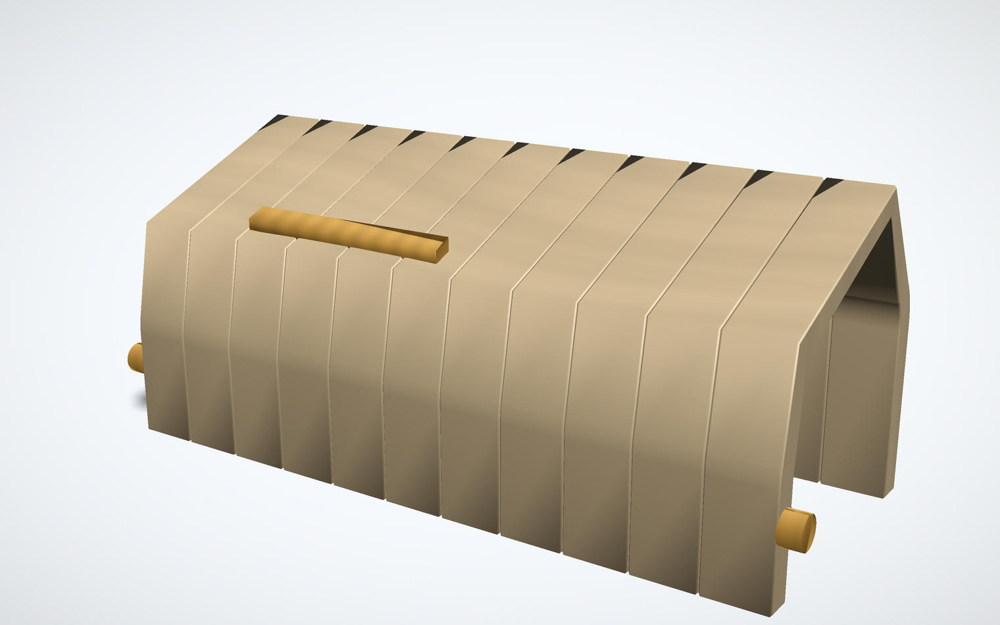

# AeroBridge Studio — product 1

A laptop stand and desk riser, built as a stack of eleven ply laminations.



## What it is

One arch, 520 mm wide and 222 mm tall, standing on the desk with a foot at
each end. The top of the arch is a **flat 23° seat** that a laptop lies on; the
space under the seat is a **garage** that a keyboard slides into. The front roll
of the arch is the stop, so the laptop rests against the form itself rather than
against a stuck-on lip.

The arch is not one part. It is **eleven laminations sawn from the same
section**, and no two are the same shape: the back shoulder waves across the
stack while the seat and the feet stay identical. Standing side by side they
read as one continuous surface with a ripple running across it, which is the
whole idea — the object is complex because it is genuinely made of eleven
different parts, not because something has been bolted on.


## Why it is built this way

| | |
|---|---|
| **Wall** | 18 mm everywhere, and it is exactly 18 mm in all eleven laminations. |
| **Seat** | One plane at 23.0°. Every lamination's seat vertices are snapped onto it, so a laptop lands on all eleven instead of rocking on two. |
| **Garage** | 154 mm tall at the back, rising to 218 mm at the front. Clears a keyboard with room for your hands. |
| **Stretcher** | One 8 mm brass rod through all eleven, 5 mm of wood outside it and 5 mm inside. |
| **Feet** | Flat on the mat in every lamination, with felt under the four that carry load. |
| **Parts** | 19. Eleven are flat and cut from sheet, so every one ships with its own DXF. |

## The one number that matters

The section is described once, as an outer path — back toe, up the back, over
the seat, down the front, front toe — with a tangent arc at every corner. The
inner path is that same dense path pushed inward by exactly one wall.

The important consequence is the order of operations in `lamination_profiles`:
the outer path is **deformed first**, and the inner path is then re-derived as
an offset of the *deformed* path. Offsetting first and deforming afterwards —
which is what this started as — gives a wall that is 18 mm in the base section
and wrong by up to 20 % in every other one. The wall is what carries the
laptop, so it is not allowed to vary.

## Files

```
parts/stl/    19 watertight STLs, one per part
parts/dxf/    12 DXFs: one per lamination, plus L_Stack_All_Laminations.dxf
              which is all eleven nested onto one sheet
parts/BOM.csv, parts/CUTTING_LIST.csv
parts/renders/ hero, hero_side, exploded, and five part shots
AeroBridge_Studio.py   builds all 30 bodies in Fusion 360
```

## Rebuilding it

From `desk_system_v3`:

```sh
../.venv/bin/python studio_common.py        # parameters + part list
../.venv/bin/python studio_fusion_data.py   # rewrite the Fusion script's data
../.venv/bin/python studio_render.py        # renders
../.venv/bin/python studio_export.py        # STL + DXF + BOM
../.venv/bin/python verify_studio.py        # must print four PASS lines
```

`verify_studio.py` checks, in order: that the Fusion script actually builds the
bodies; that the geometry holds the claims above (simple sections, a flat seat,
the stretcher inside solid wood, a garage you can put a keyboard in); that
every STL is watertight; and that every part has a file.

## Making it

The eleven laminations are **flat parts**. Cut them from 18 mm birch ply with
the nesting sheet, keep them in numbered order, and glue and clamp the stack.
The stretcher bore is drilled in the DXF as part of each lamination, so the rod
lines up across all eleven without a jig — but check it with a rod before the
glue goes on.

Then one 8 mm brass rod, two brass collars, a brass seat stop let 0.4 mm into
the seat, and four felt pads. Nothing else. No fasteners are visible from the
front, and the only metal in the object is the one line of brass running
through the feet.
