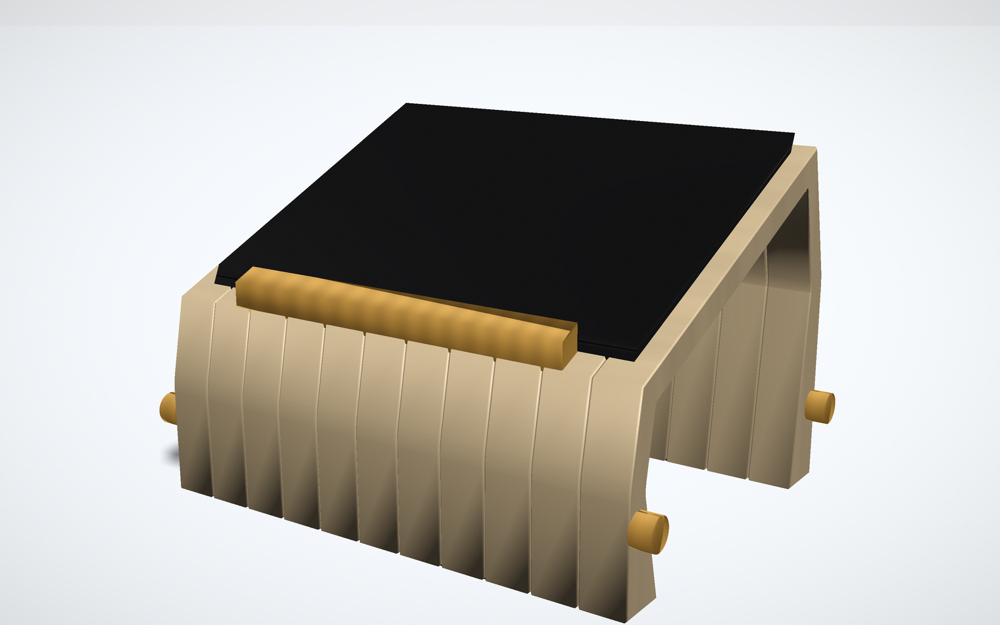
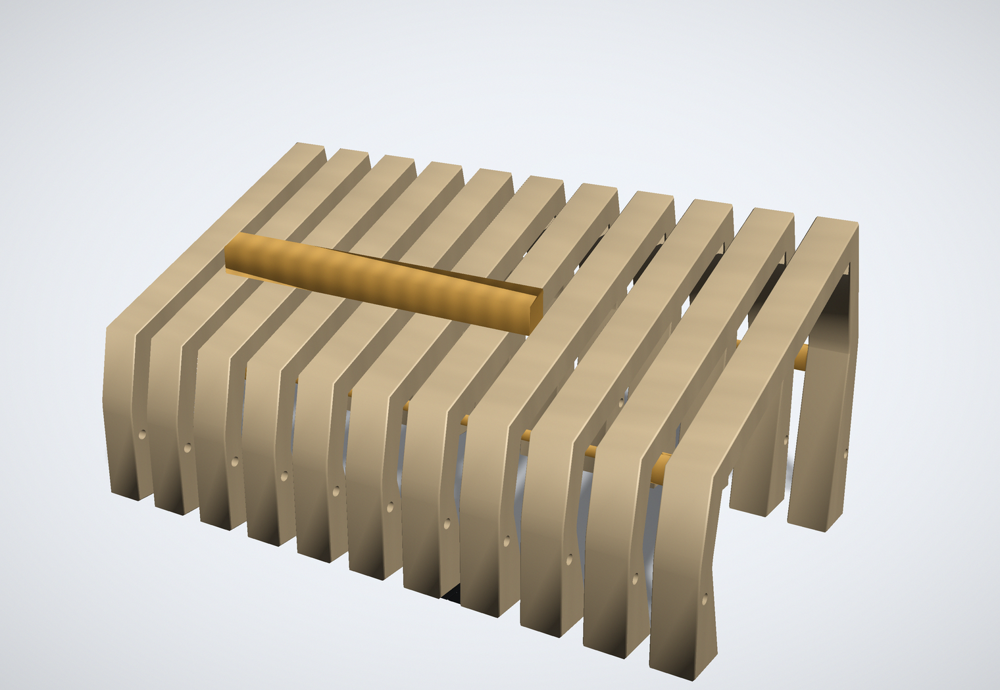

# AeroBridge Studio — product 1

A laptop stand, built as a stack of eleven ply laminations.



## What it is

A 372 mm wide, 246 mm tall arch standing on the desk on a foot at each end.
The top is a **deck that runs down toward you at 23.3°** — a 240 mm laptop
lands on it at a comfortable working angle — and a **brass stop bar** stands on
the deck's front edge and catches the machine before it can slide into the
keyboard. The space underneath is a garage 232 mm deep that a keyboard and a
mouse retreat under when the desk needs to be a desk again.

The stop is the part that makes this a stand rather than a shelf, so it is not
decoration: it is 18 mm of solid brass, its underside is machined to the deck's
23.3° plane so it beds down along its whole length, and it is set flush with the
deck's front edge so not one millimetre of the deck is spent behind it.

The arch is not one part. It is **eleven laminations sawn from the same
section**, and no two are quite the same shape: the back shoulder waves across
the stack while the deck and the feet stay identical. Standing side by side
they read as one continuous surface with a ripple running across it. The object
is complex because it is genuinely eleven different parts, not because
something has been bolted on.



## The number that got this wrong the first time

The first version of this stand had a deck only **146 mm** deep. A 240 mm
laptop needs 240 mm of face, or 249 mm along a 23° slope, plus a stop. It was
75 mm short and had no stop at all — you could not have put a laptop on it.
It read as a table because that is what it was.

So the deck is now **267.9 mm of face**, of which the stop takes 16 mm, which
leaves **251.9 mm for a 240 mm machine**. `verify_studio.py` measures exactly
that — the usable face, the stop's height above the deck measured along the
deck normal, and whether the stop is set at the front edge — and fails if any
of it stops being true. It is not a claim in a README; it is a test.

## Why it is built this way

| | |
|---|---|
| **Deck** | 267.9 mm of face at 23.3°. It is one plane in all eleven laminations, so a laptop lands on all eleven instead of rocking on two. |
| **Stop** | 18 mm proud of the deck, 264 mm long, flush with the front edge. |
| **Wall** | 18 mm everywhere, and exactly 18 mm in all eleven laminations. |
| **Garage** | 232 mm of clear depth, 220 mm high at its tallest, 138 mm at the front. Clears a keyboard with room for your hands. |
| **Stretchers** | Two 8 mm brass rods through all eleven, 5 mm of wood outside each and 5 mm inside. |
| **Feet** | Flat on the mat in every lamination, felt under the two toes that carry the load. |
| **Parts** | 22. Eleven are flat and cut from sheet, so every one ships with its own DXF. |

## The one idea worth explaining

The section is described once, as an outer path — back toe, up the back, over
the deck, down the front, front toe — with a tangent arc at every corner. The
inner path is that same dense path pushed inward by exactly one wall, and the
push uses the **miter length** `wall / cos(half-angle)`, recovered as
`2 / |n1 + n2|`, because a constant-width offset along the bisector pinches the
wall shut at every corner. Getting that wrong is what made the wall cross
itself at (80, 208).

The important consequence is the order of operations in `lamination_profiles`:
the outer path is **deformed first**, and the inner path is then re-derived as
an offset of the *deformed* path. Offsetting first and deforming afterwards
gives a wall that is 18 mm in the base section and wrong by up to 20 % in every
other one. The wall is what carries the laptop, so it is not allowed to vary.

Everything the laptop touches — the deck plane, the stop, the front edge — is
**identical in all eleven laminations**, and the ripple lives entirely in the
back crown, where nothing rests.

## Files

```
parts/stl/    22 watertight STLs, one per part
parts/dxf/    12 DXFs: one per lamination, plus L_Stack_All_Laminations.dxf
              which is all eleven nested onto one sheet
parts/BOM.csv, parts/CUTTING_LIST.csv
parts/renders/ hero, hero_side, in_use, exploded, and five part shots
AeroBridge_Studio.py   builds all 44 bodies in Fusion 360
```

## Rebuilding it

From `desk_system_v3`:

```sh
PYTHONPATH=. ../.venv/bin/python studio_common.py       # parameters + part list
PYTHONPATH=. ../.venv/bin/python studio_fusion_data.py  # rewrite the Fusion data
PYTHONPATH=. ../.venv/bin/python studio_render.py       # renders
PYTHONPATH=. ../.venv/bin/python studio_export.py       # STL + DXF + BOM
PYTHONPATH=. ../.venv/bin/python verify_studio.py       # must print four PASS lines
PYTHONPATH=. ../.venv/bin/python look_laptop.py         # acceptance render
```

`verify_studio.py` checks, in order: that the Fusion script actually builds the
bodies; that the geometry holds the claims above (simple sections, a deck at
the right angle, 240 mm of usable face in front of a stop that really stands
proud, the stretchers inside solid wood, a garage you can put a keyboard in);
that every STL is watertight; and that every part has a file.

`look_laptop.py` is the one that answers the original question. It seats a
340 × 240 × 16 mm machine against the stop and prints the fit, then draws it.

## Making it

The eleven laminations are **flat parts**. Cut them from 18 mm birch ply with
the nesting sheet, keep them in numbered order, and glue and clamp the stack.
The stretcher bores are drilled in the DXF as part of each lamination, so the
rods line up across all eleven without a jig — but check them with a rod before
the glue goes on.

Then two 8 mm brass rods, four brass collars, the brass seat stop, and four
felt pads. Nothing else. No fastener is visible from the front, and the only
metal in the object is the brass: two lines running through the feet and one
bar across the front, under the machine.
