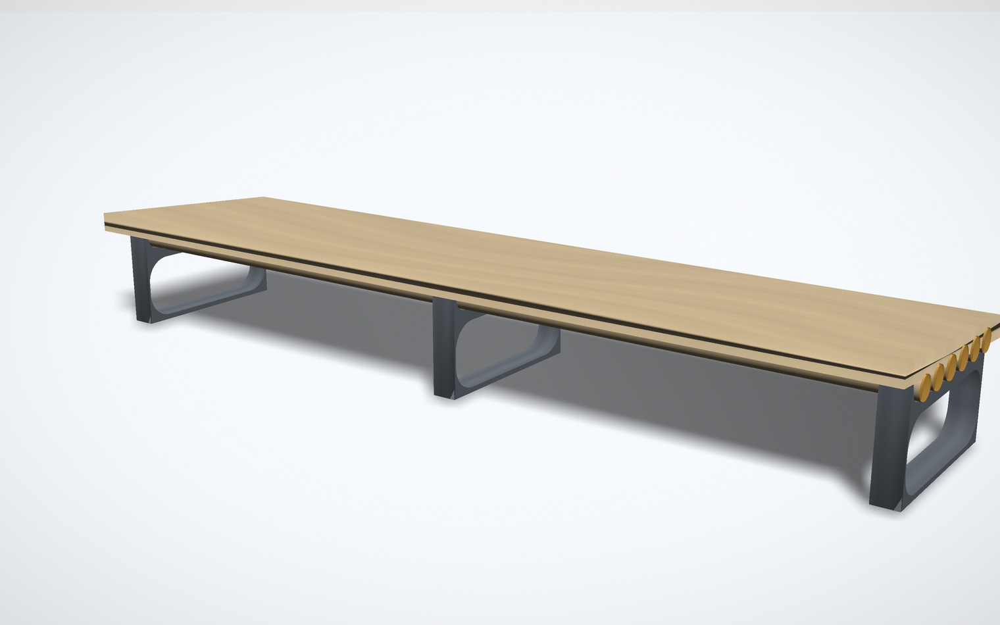
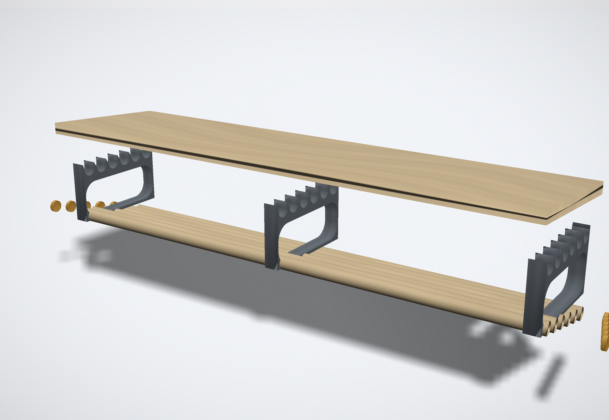
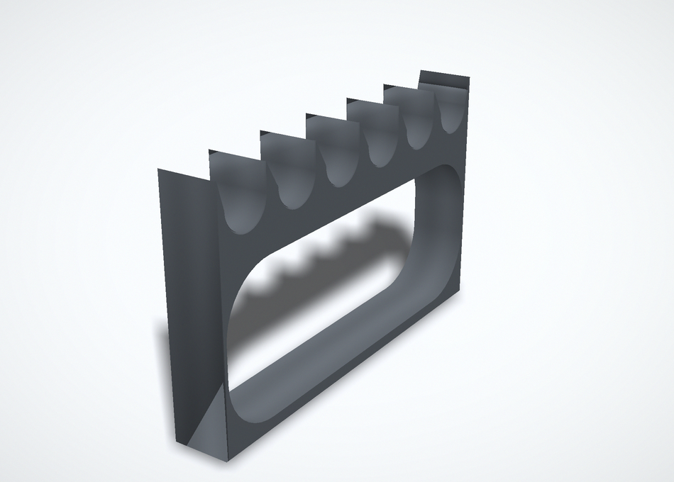

# DraftShelf — product 6

A modular desk shelf: six ash dowels, three machined aluminium combs, one board.
The dowels are the deck. The combs are the whole joint. Nothing is glued and
nothing is printed.



## What it is, and what it is not

This is my take on The Workspace Hero's DeskShelf, which I was pointed at. It is
**not a copy and not a print**: the referenced system is a family of 3D-printed
saddles, and this replaces that with one billet aluminium part that does the
same job better, because a machined scallop holds a 22 mm dowel on a tolerance
instead of a rattle.

The structure is the reference's, and I got it wrong twice before I read its
parts list properly. It is not three legs with a shelf on top. It is:

- **six 22 mm dowels, 900 mm long, laid side by side as a raft** on a 30 mm
  pitch — these are the structure and the deck in one;
- **three combs** that cradle all six at once, left, middle and right;
- **a 20 mm ash board** on top, which is the shelf;
- **twelve brass plugs** in the dowel ends, so no end grain shows.

That is the whole thing. The raft is 180 mm deep and the board is 241, so it
is **902 × 241 × 131 mm** overall, and it takes a monitor on top and a keyboard
underneath.



## The one part that is engineered

**J01, the comb.** Everything else in this product is bought stock. The comb is
the only thing you make, and it is the reason the system works.

A single billet of 6061-T6, 26 × 180 × 111 mm, gets six scallops of **R11.6**
cut into its top edge on a **30 mm pitch**, with a **2 mm flat** left at the top
of each tooth between them. The scallop radius is 0.6 over the dowel radius —
enough that a sawn dowel drops in, and enough that two polygons with different
segment counts cannot interleave and chew each other in a depth buffer.

The datum is the point. All six scallops are cut in **one setup from one pitch**,
so they cannot drift relative to each other. That is what a printed saddle
cannot give you: six independent prints each hold their own ±0.3, and the raft
goes bananas. Here the six dowels are held on 30 ± 0.05 across the whole width
of the desk, and because the pitch is a parameter, a 1200 mm shelf is the same
part with a different dowel length.

Then a **177 × 68 mm window is cut through the comb's web**. Without it the
comb is a 180 × 111 slab, 1.40 kg of aluminium before it has done anything.
With it, what is left is a scalloped rail on two slim legs, the comb drops to
1.20 kg, and the machining is visible from the front.

The window's top edge has to stay clear of the cradle arcs, and this is a real
constraint rather than a style choice: at 10 mm below the cradle floor the edge
passed **0.16 mm** from a scallop, and earcut silently collapsed the sliver,
dropping six boundary vertices and leaving 26 loose edges in the STL that no
render would ever show you. At 24 mm below the floor there is 12.8 mm of
clearance and the part is watertight. That is why the window is squat and wide
rather than tall.

Be clear about what that window is for, because it is not a keyboard tunnel.
The keyboard does not pass through it: the rail across the front of the comb
is closed off. The window is there to **take the dead mass out of the part**,
which takes 0.20 kg off every comb — 0.6 kg off the object — and is why the
legs read as legs.



## Why not just print it

| | printed saddle | this |
|---|---|---|
| Dowel bore | ±0.3 mm, rattles | reamed, 0.6 mm on radius |
| Pitch accuracy | one per part | six per setup, 30 ± 0.05 |
| Raft depth tolerance | ±0.6 mm across a shelf | one number, held |
| Load | creeps under a monitor in a warm room | 6061-T6 |
| Finish | layer lines in the one part you touch | anodised, chamfered |

Printing is the right answer for the add-ons — drawers, hangers, chargers. It is
the wrong answer for the part that sets every dimension in the product.

## Why it looks the way it does

Three rules, held throughout:

1. **The dowels are stock, and they look it.** Round ash, saw-finished ends
   covered by brass. The square edge of the board against the round of the
   dowels is the whole contrast; nothing else is allowed to compete.
2. **The metal is one dark silhouette.** The combs are the only dark mass, and
   they are the same dark in every view. The only bright metal is twelve 22 mm
   brass discs and they are flush, not proud.
3. **One void, and it is the point.** The window in the comb is what stops the
   object reading as a solid block of shelf, and it is what lets 111 mm of
   daylight under the board read as space a keyboard can be pushed into — from
   the sides, between the combs, not through the metal.

## Parts

| tag | part | qty | material |
|---|---|---|---|
| J01 | Comb | 3 | 6061-T6, clear anodised |
| R01 | Dowel | 6 | 22 mm ash, 900 mm |
| S01 | Shelf | 1 | 20 mm ash board, 900 × 241 |
| C01 | End Cap | 12 | CZ121 brass, brushed |
| F01 | Pad | 3 | 95A TPU |

Five part numbers, 25 solids, 900 mm of desk. Every part ships as its own STL;
the two flat parts also ship as DXF.

## Files

```
parts/stl/      one watertight STL per part (5)
parts/dxf/      the flat parts, cut-ready (2)
BOM.csv         part, quantity, material, file
CUTTING_LIST.csv stock to buy, with sizes
parts/renders/  hero, hero_side, front, detail, exploded, and one per part
```

## Rebuilding it

From `desk_system_v3/draftshelf`:

```sh
PYTHONPATH=..:. ../../.venv/bin/python build.py     # numbers + solids
PYTHONPATH=..:. ../../.venv/bin/python export.py    # STL + DXF + BOM
PYTHONPATH=..:. ../../.venv/bin/python render.py    # the render set
PYTHONPATH=..:. ../../.venv/bin/python verify.py    # must print four PASS lines
```

`verify.py` checks that every part is watertight (by position, because
`prism_with_hole` gives its end caps their own boundary vertices on purpose),
that the dowels really seat in the scallops with radial clearance, that the
shelf lands on all six dowels in one plane and covers the raft, and that every
part has a file and appears in the BOM.

## Making it

1. Buy the stock: 6 × 900 mm of 22 mm ash dowel, one 900 × 241 × 20 ash board,
   3 billets of 6061 at 26 × 180 × 111, 12 brass plugs.
2. Machine the combs. One setup each: profile the outline, cut the six R11.2
   scallops, cut the 177 × 68 window, face the base, chamfer 0.6 everywhere.
3. Cut the board to size and 2 mm round on the top edges.
4. Press the brass plugs into the dowel ends, 6 mm deep, flush.
5. Stand the combs, drop the six dowels into the scallops, and lay the board on.
   **There are no fasteners.**

   Be precise about what holds what, because it is easy to get backwards. The
   board does not clamp the raft down; it stops the dowels **lifting out** of
   the scallops. A dowel in an 11.2 mm cradle can only come out upward, and the
   board sits on the six teeth across its weight. The board is 3.0 kg and the
   six dowels it is retaining total 0.47 kg, so it outweighs them 6.4:1. That is
   a real retain.

   What it is not is a rigid joint. Drag a loaded shelf across a desk and the
   combs will walk. If you need it to stay put, drill the combs for an M5 and
   screw the board down — there is 26 mm of web under each scallop for it — or
   just put a strip of 1 mm rubber between the board and the teeth. I left the
   holes out because the assembled object is better without them, and I would
   rather tell you the limitation than hide it.

6. Stick the TPU pads under each comb.

Knock-down: lift the board, lift the six dowels out, and the whole thing packs
flat in a 950 × 250 × 130 box.
